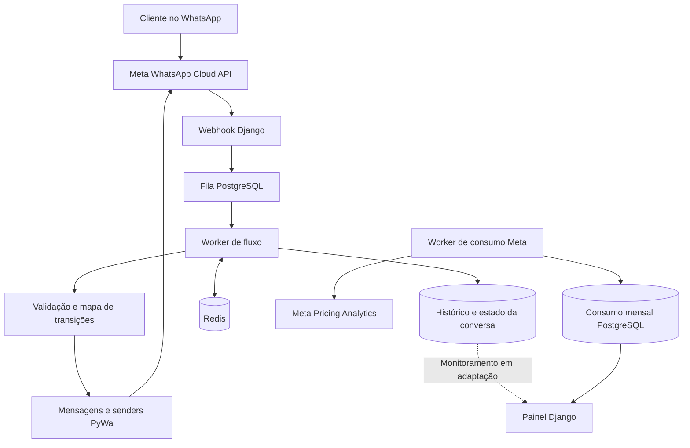

# Chatbot do Baratão Móveis

Sistema de atendimento automatizado de pós-venda pelo WhatsApp, desenvolvido para a central de atendimento do Baratão Móveis. O assistente virtual **Theo** realiza a triagem inicial dos clientes, coleta informações sobre a compra e direciona o atendimento aos setores responsáveis por Móveis e Estofados.

O projeto utiliza um fluxo determinístico, com etapas e transições controladas pelo banco de dados, processamento assíncrono de mensagens e persistência do histórico de atendimento. Também possui uma interface web de monitoramento e um componente independente de acompanhamento do consumo da API da Meta.

**Estado do projeto — 25/11/2026:** em desenvolvimento. As etapas iniciais do pós-venda e o módulo de consumo Meta estão implementados, mas a adaptação integral do atendimento ainda não foi concluída. Esta versão não está liberada para operação completa em produção.

## Objetivos

- Centralizar a entrada de clientes das diferentes lojas em um único canal de pós-venda.
- Padronizar a coleta de informações antes do atendimento humano.
- Identificar o produto, o assunto e a filial de origem da compra.
- Direcionar o cliente à equipe responsável, aproveitando os dados já coletados.
- Reduzir atividades repetitivas da equipe e manter a rastreabilidade dos atendimentos.
- Monitorar os volumes de mensagens e o consumo da integração com a Meta.

## Fluxo de atendimento

O catálogo vigente possui **9 etapas e 29 transições**. Os identificadores são definidos em `core/etapas_pos_venda.py` e as transições autorizadas pelo catálogo SQL do PostgreSQL.

| Etapa | Responsabilidade | Estado atual |
| --- | --- | --- |
| 1 | Saudação do Theo e coleta do nome completo do titular | Implementada |
| 2 | Coleta e validação do formato do CPF | Implementada |
| 3 | Identificação do produto: Estofados, Móveis ou Ambos | Implementada |
| 4 | Identificação do assunto do atendimento | Implementada |
| 6 | Coleta dos números dos pedidos ou registro de nota perdida | Implementada |
| 7 | Confirmação da visita à loja em casos de assistência | Pergunta implementada; processamento da resposta pendente |
| 8 | Orientação e encerramento quando a visita à loja está pendente | Prevista no catálogo |
| 9 | Coleta dos detalhes da situação | Pergunta implementada; processamento da resposta pendente |
| 11 | Encaminhamento e encerramento do atendimento | Implementada no tratamento universal; encerramento normal após detalhes pendente |

Os IDs 5 e 10 não são utilizados. A cidade não faz parte da coleta atual.

### Abertura e retorno

- Quando falta o nome do titular, o atendimento começa na etapa 1.
- Quando o nome já está cadastrado, mas falta o CPF, começa na etapa 2.
- Quando nome e CPF já estão cadastrados, uma nova conversa começa na etapa 3, respeitando eventual bloqueio vigente.
- Se houver uma conversa ativa, o atendimento retoma a etapa persistida.

Nome e CPF são armazenados no cadastro global do cliente e na cópia do atendimento. Produto, assunto e pedidos pertencem à conversa, evitando reutilizar indevidamente informações de uma compra anterior. A validação do CPF verifica seu formato, sem comprovação de identidade ou consulta à Receita Federal.

### Produtos e assuntos

O cliente seleciona Estofados, Móveis ou Ambos. Na sequência, pode escolher um dos seguintes assuntos:

- **Entrega:** previsão de entrega do produto.
- **Assistência:** avarias no produto.
- **Montador:** necessidade de montagem.
- **Misto:** dois ou mais assuntos.
- **Outros:** solicitações não contempladas nas opções anteriores.

A etapa 6 aceita múltiplos números de pedidos na mesma mensagem, identifica a filial pelos dois dígitos finais de cada pedido e permite informar a perda da nota por texto ou botão. O catálogo inicial possui 26 filiais cadastradas.

Após a coleta dos pedidos, casos de assistência seguem para a pergunta de visita à loja (etapa 7); os demais assuntos seguem para a pergunta de detalhes (etapa 9). O processamento completo dessas respostas é uma entrega pendente.

### Encaminhamento humano e tratamento universal

As etapas 1, 2, 3, 4 e 6 compartilham o tratamento de mídias não suportadas, solicitações de atendimento humano e entradas repetidas sem avanço. Após três repetições consecutivas, uma quarta entrada aciona o encaminhamento.

O encaminhamento apresenta os contatos de pós-venda conforme o produto escolhido. Quando ainda não existe produto definido, apresenta os dois setores. Os dados disponíveis da conversa podem compor o resumo encaminhado no link do WhatsApp.

Após a confirmação do encaminhamento, o fluxo registra o encerramento e aplica um bloqueio interno de 90 dias por cliente e central. Esse bloqueio não equivale a um bloqueio na plataforma WhatsApp. A etapa 8, prevista para visita pendente, possui regra distinta de retorno imediato.

O atendimento humano ocorre nos números de destino; a apresentação dos contatos não significa que o cliente já enviou uma mensagem à equipe.

## Arquitetura

A aplicação mantém a separação entre recepção HTTP, processamento do fluxo, validação, envio de mensagens, persistência e monitoramento.



O diagrama representa a arquitetura-alvo do atendimento e os componentes existentes; o webhook completo e parte do painel ainda estão em adaptação.

O worker de fluxo utiliza locks, controle de ordem, checkpoints e transações para preservar a consistência das conversas e recuperar processamentos interrompidos. Respostas já confirmadas podem ser recuperadas sem novo envio. A confirmação externa pela Meta e o commit local não são atômicos entre si: uma falha entre ambos ainda pode causar duplicação na recuperação.

### Tecnologias

| Tecnologia | Utilização |
| --- | --- |
| Python 3.12 | Linguagem principal |
| Django 6.0.2 | Webhook, autenticação e interface de monitoramento |
| PostgreSQL / Psycopg 3 | Fila, catálogo, cadastros, histórico e consumo |
| Redis | Cache e mecanismos de proteção operacional |
| WhatsApp Cloud API / PyWa 4.5.0 | Integração e envio de mensagens interativas |
| HTML, CSS e JavaScript | Interface de monitoramento |
| ReportLab e svglib | Geração de relatórios de consumo em PDF |
| Gunicorn, Nginx e systemd | Componentes de implantação em Linux |
| unittest | Testes unitários, de arquitetura e integração |

As versões completas das dependências estão em [requirements.txt](requirements.txt).

## Estrutura do projeto

```text
baratao-chatbot/
├── callback/
│   ├── callback/             # Configurações Django e rotas principais
│   ├── webhook/              # Recepção de eventos do WhatsApp
│   └── monitoramento/        # Interface web e relatórios
├── core/
│   ├── cache/                # Redis e cache de execução
│   ├── consumo_meta/         # Regras de apuração de consumo
│   ├── database/             # Conexão, DDL e catálogo SQL
│   ├── integrations/         # Integração WhatsApp, mensagens e senders
│   ├── repositories/         # Consultas e persistência de dados
│   ├── validacoes/           # Validadores e extratores
│   └── etapas_pos_venda.py   # IDs e eventos do fluxo
├── workers/
│   ├── worker_flow/          # Processamento do atendimento
│   └── worker_consumo_meta/   # Coleta independente de consumo
├── deploy/                   # Migrações, Nginx e unidades systemd
├── regras_deploy/            # Procedimentos operacionais
├── tests/                    # Testes automatizados e fixtures SQL
├── utilitarios/               # Ferramentas auxiliares
└── requirements.txt          # Dependências Python
```

Estrutura resumida, com foco nos componentes do Baratão. Alguns módulos e arquivos do sistema anterior ainda permanecem no repositório durante a migração.

## Monitoramento e consumo Meta

O módulo de consumo está adaptado ao varejo e opera por central e mês. A coleta é independente do worker de atendimento e não envia mensagens aos clientes.

- Separação entre mensagens na janela gratuita, reserva gratuita Meta e mensagens cobradas pela Meta.
- Cobertura comercial ESL Tech de 1.000 mensagens cobradas por mês, contabilizada separadamente da reserva Meta.
- Consulta do histórico, seleção de período e geração de PDFs mensais e históricos.
- Coleta periódica via `pricing_analytics`, com agenda persistida e preservação da última leitura válida em caso de falha.
- Consolidação interna conforme conferência dos volumes, sem equivaler ao fechamento da fatura Meta.
- Autenticação Django e restrição de acesso à central vinculada ao operador.

As abas de conversas e demais relatórios ainda precisam ser integralmente adaptadas ao novo modelo de pós-venda.

Consulte o [guia de consumo Meta](deploy/consumo_mensal_meta.md) para configuração, apuração, migração e operação.

## Desenvolvimento local

Requisitos: Python 3.12, PostgreSQL e Redis, além das configurações de desenvolvimento da integração WhatsApp para testes externos autorizados.

Na raiz do projeto, em PowerShell:

```powershell
python -m venv .venv
.\.venv\Scripts\Activate.ps1
python -m pip install -r requirements.txt
```

Configure as variáveis de ambiente necessárias conforme [core/config_env.py](core/config_env.py). Utilize um arquivo `.env` privado e credenciais exclusivas de desenvolvimento.

Com o banco e o ambiente configurados, verifique o Django:

```powershell
python callback/manage.py check
```

Para iniciar o servidor local, quando o ambiente estiver preparado:

```powershell
python callback/manage.py runserver
```

O setup de uma base nova e a atualização de uma base existente seguem procedimentos diferentes. Consulte o [guia do banco de dados](core/database/README.md) antes de executar scripts SQL. Não aplique migrações históricas sobre uma instalação limpa que já utiliza o DDL e o catálogo vigentes.

## Testes automatizados

Para executar testes unitários das etapas de pós-venda e da arquitetura, a partir da raiz:

```powershell
python -m unittest tests.test_etapa1_pos_venda tests.test_etapa2_pos_venda tests.test_etapa3_pos_venda tests.test_etapa4_pos_venda tests.test_etapa6_pedidos -v
python -m unittest tests.test_arquitetura_pos_venda tests.test_abertura_digitacao_pos_venda tests.test_consumo_meta_varejo -v
```

As suítes de integração com PostgreSQL exigem bancos locais descartáveis com nome iniciado por `baratao_`. As conexões são configuradas pelas variáveis `BARATAO_TEST_DSN` e `BARATAO_CONSUMO_TEST_DSN`, respectivamente. Os testes recriam o schema `chatbot` nas bases de ensaio; nunca utilize uma base de produção.

```powershell
python -m unittest tests.test_etapa1_pos_venda_postgres tests.test_consumo_meta_varejo_postgres -v
```

A documentação registra 132 testes aprovados na revisão de 22/11/2026, antes das entregas posteriores de assunto e pedidos. Esse resultado é histórico e não constitui uma nova execução ou certificação da versão de 25/11/2026.

Mais informações em [tests/README.md](tests/README.md).

## Implantação

Os componentes mantidos para a arquitetura do Baratão são o serviço web (webhook e painel), o worker de fluxo e o worker de consumo Meta. Os arquivos de referência estão em [deploy/systemd](deploy/systemd) e [deploy/nginx](deploy/nginx).

A atualização do banco existente exige backup, aplicação dos complementos adequados ao estado da base e validação antes da inicialização dos serviços. Consulte o [guia do banco](core/database/README.md) e os [procedimentos de deploy](regras_deploy/rotina_deploy.md).

A presença de unidades systemd do sistema anterior não autoriza a inicialização de workers legados. Não iniciar o atendimento completo em produção enquanto as adaptações pendentes não forem concluídas e verificadas.

## Segurança e privacidade

O sistema trata dados pessoais, incluindo nome, CPF e telefone. O código e a documentação não devem expor dados reais de clientes, credenciais, tokens da Meta, senhas ou backups do banco de dados.

Manter configurações sensíveis fora do Git, utilizar acessos restritos por central e evitar o registro em logs de URLs de encaminhamento que contenham CPF. Utilizar dados fictícios nos ensaios e respeitar as obrigações aplicáveis da LGPD.

## Próximas entregas

- Concluir a adaptação integral do webhook e das proteções de entrada ao modelo de varejo.
- Implementar o processamento da resposta à visita à loja (etapa 7) e o encerramento por visita pendente (etapa 8).
- Implementar a coleta e persistência dos detalhes (etapa 9) e o encaminhamento normal de conclusão (etapa 11).
- Adaptar as abas de conversas e relatórios do painel ao pós-venda.
- Revisar e remover dependências e documentações legadas que não pertencem ao novo atendimento.
- Validar o fluxo completo, as migrações e a implantação antes de liberar a operação em produção.

## Documentação técnica

| Documento | Conteúdo |
| --- | --- |
| [Fluxo de pós-venda Baratão](<baratão moveis.md>) | Roteiro, mensagens, regras, etapas e decisões vigentes |
| [Banco de dados](core/database/README.md) | DDL, catálogo e migrações |
| [Consumo Meta](deploy/consumo_mensal_meta.md) | Apuração, coleta e relatórios |
| [Workers](workers/README.md) | Responsabilidades e distinção entre serviços atuais e legados |
| [Testes](tests/README.md) | Cobertura, execução e resultados registrados |
| [Rotina de deploy](regras_deploy/rotina_deploy.md) | Procedimentos operacionais |
| [Padrões de arquitetura](PADROES_DE_ARQUITETURA.md) | Referência dos padrões herdados da base anterior |
| [Regras de negócio](REGRAS_DE_NEGOCIO.md) | Referência legada, sujeita à revisão para o varejo |
| [Versionamento](VERSIONAMENTO.md) | Histórico da base de código |

O documento de fluxo do Baratão e o catálogo SQL vigente devem orientar as regras do novo atendimento. Documentos e módulos herdados do Supera não devem ser interpretados como funcionalidades ativas do Baratão sem confirmação no código atual.

## Licença

Consulte o arquivo [LICENSE](LICENSE) para os termos de licenciamento do repositório.
