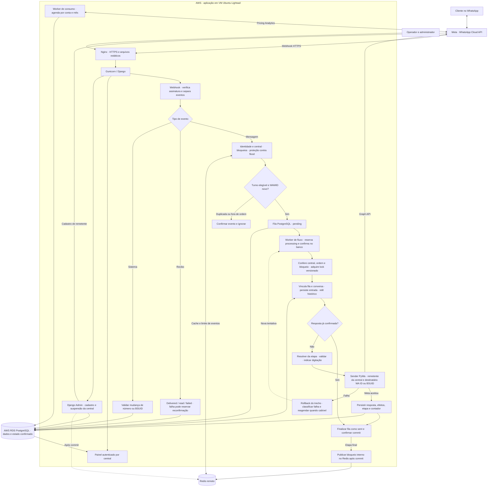

# Arquitetura do sistema em produção

A entrada e a resposta de uma mensagem percorrem processos diferentes. O webhook confirma que a entrada ficou na fila. O worker usa o mesmo `id_mensagem` para registrar a resposta e a conclusão no PostgreSQL. Uma confirmação de entrega da Meta pode chegar mais tarde.

[Abrir o fluxograma em SVG para ampliar](fluxograma_arquitetura.svg)

| Ponto de decisão | Comportamento e recuperação |
| --- | --- |
| Entrada HTTPS | O Nginx recebe o callback e encaminha a requisição ao Django. O GET permite a verificação da Meta. No POST, o webhook confere o corpo, a assinatura configurada e o vínculo do número empresarial. Eventos de sistema e recibos têm caminhos próprios. |
| Identidade | O número do cliente e o BSUID podem chegar juntos ou separados. O username é um atributo de apresentação. Uma identidade ausente ou conflitante impede abrir atendimento. Uma falha específica no telefone pode reservar reconfirmação pelo BSUID. |
| Segurança | O bloqueio por abuso tem registro próprio no banco e integração de bloqueio com a Meta. A contagem de flood usa Redis, PostgreSQL e, em último caso, memória do processo. O bloqueio interno de 90 dias é consultado no Redis e confirmado no banco em caso de ausência. |
| Turno | Com o lock transacional de entrada, a fila aceita um turno quando não há entrada anterior aberta ou quando a anterior já tem resposta confirmada. Enquanto aguarda resposta, mensagens adicionais ficam fora da fila. A data de interação também impede uma reentrega fora de ordem. |
| Proteção do processamento | A reserva da fila e o lock versionado da conversa têm prazos distintos. O worker volta a conferir ordem, central e posse do lock. Uma central ativa ausente do cache é confirmada no PostgreSQL e o mapa pode ser reparado no mesmo ciclo. |
| Queda durante o envio | Uma resposta já persistida permite finalizar a fila sem reenviar ou contar de novo. Se a Meta aceitou o envio antes de uma falha no commit, o retry pode duplicar a mensagem externa. Falhas de transporte e de banco seguem a política do worker. |
| Consumo e painel | O worker de consumo guarda a última coleta válida de Pricing Analytics. A seção Consumo e os PDFs leem o banco por central e mês. As consultas do painel e do Django Admin compartilham o processo web. Algumas métricas legadas ainda dependem da adaptação ao varejo. |
| Operação | Na VM, `systemd` supervisiona o serviço web e os dois workers. O GitHub guarda a versão publicada na branch `prod`. O ambiente da instalação fica em `/etc/chatbot/chatbot.env`. Pelo journal, `id_mensagem` acompanha a fila e `ref_envio` permite correlacionar o envio e um recibo de falha. |

Por exemplo, se o worker confirmou a resposta à mensagem A e caiu antes de marcar a fila como concluída, o webhook pode admitir a mensagem B. Uma terceira mensagem C que chega enquanto B aguarda resposta é descartada. Na recuperação, o worker conclui A pelo histórico e processa B em ordem. [Sequência completa dos turnos](../REGRAS_DE_NEGOCIO.md)

[Ciclo transacional](../workers/worker_flow/response_flow/flow_worker.py) · [Entrada de mensagens](../callback/webhook/services/post_flow.py) · [Cache e autocura](../core/cache/README.md) · [Consumo mensal](../deploy/consumo_mensal_meta.md)

Na Beta V0.2.1, o administrador pode consultar as dependências antes de excluir uma central e suspendê-la para preservar o histórico. O operador usa o portal associado à sua central. As duas interfaces compartilham o serviço web. [Cadastro, consultas e exclusão no Admin](../callback/README.md#admin-e-painel)
