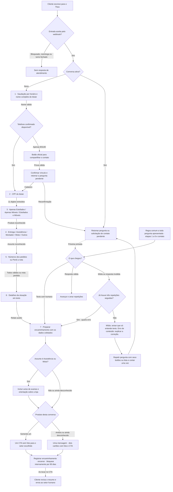

# Fluxo de atendimento do Theo

A primeira mensagem abre a conversa e recebe a saudação, mesmo se contiver uma foto ou um pedido de humano. A partir da próxima entrada aceita, as regras de repetição e encaminhamento valem para cada pergunta. Um novo atendimento após os 90 dias volta a coletar nome e CPF.

[Abrir o fluxograma em SVG para ampliar](fluxograma_atendimento.svg)

| Pergunta pendente | Respostas e desvios |
| --- | --- |
| Nome do titular | Aceita nome completo em texto, inclusive apresentações reconhecidas como “Eu me chamo Ana Souza”. Um nome inválido repete a coleta. Para mídia, o Theo diz “Olha, só consigo entender mensagens de texto.” e pede novamente o nome completo. |
| Compartilhamento do telefone | Para cliente apenas com BSUID sem telefone confirmado, o botão aparece entre nome e CPF. Um telefone livre passa a ser o destino. Na V0.3.0, se o telefone já pertence a outro cadastro, a decisão de unir aguarda o CPF. Se outro cadastro tem o CPF, vence primeiro o par CPF e telefone e depois o CPF, com desempate pelo maior ID antigo. As conversas passam ao vencedor por central. Se só o telefone coincide, o maior ID antigo com esse número recebe o CPF desta compra. A rota do telefone é usada nos próximos envios após a fusão. [Exemplo](conciliacao_cliente_por_cpf.md). Texto com número digitado repete o botão. Áudio, imagem ou cartão sem prova repetem o botão e o aviso de texto. Uma reconfirmação posterior retorna à pergunta interrompida. |
| CPF do titular | Aceita um CPF identificável em uma frase, com 11 dígitos ASCII e separadores opcionais de ponto ou hífen. Mantém zeros iniciais. Formato inválido ou dois CPFs diferentes geram correção. |
| Tipo de produto | Os três botões, texto com produto reconhecível e expressões como “ambos” podem avançar. A interpretação considera negação. Uma mídia repete os mesmos três botões, antes de gravar a escolha. |
| Assunto | A lista oferece previsão de entrega, avaria, montador, dois ou mais assuntos e outros. Texto com sinônimos também vale. Assuntos diferentes na mesma frase geram Misto. Uma mídia repete a lista. |
| Pedido | Cada número tem dígitos, um ponto e dois dígitos de filial cadastrada. Uma mensagem pode conter vários pedidos separados. Uma falha invalida o lote inteiro. “Perdi a nota” vale por texto ou pelo botão. Uma mídia reapresenta o botão. |
| Detalhes | Texto livre não vazio conclui o relato. Uma mídia pede a descrição em texto. O comando de humano tem prioridade sobre a coleta. |
| Encaminhamento | O botão abre o WhatsApp do setor com rascunho editável. O resumo inclui os dados disponíveis e cada nota com sua filial. O relato aparece no último parágrafo. Os dois setores usam o mesmo resumo quando recebem um carrossel. |

**Exemplo de recuperação.** No CPF, um áudio gera o primeiro aviso. Um texto com dez dígitos gera a segunda correção. Uma foto gera a terceira. Se o cliente mandar um CPF válido em seguida, recebe os botões de produto e começa a nova etapa com zero repetições. Se mandar outro áudio, recebe o contato humano e começa o bloqueio interno de 90 dias. Só um turno com resposta confirmada consome uma repetição.

[Roteiro e mensagens](<../baratão moveis.md>) · [Catálogo de transições](../core/database/deploy_database/catalogo.sql) · [Compartilhamento e reconfirmação](user_id_plano_logico_teorico.md)
